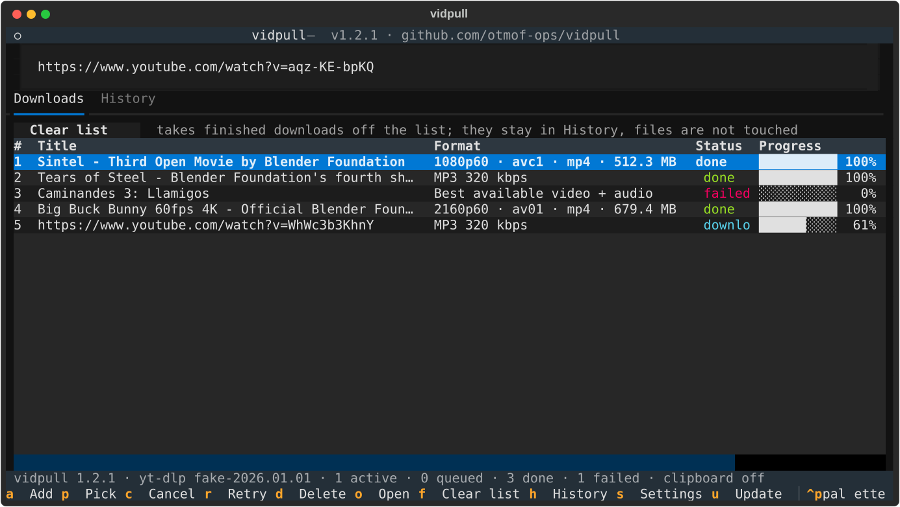
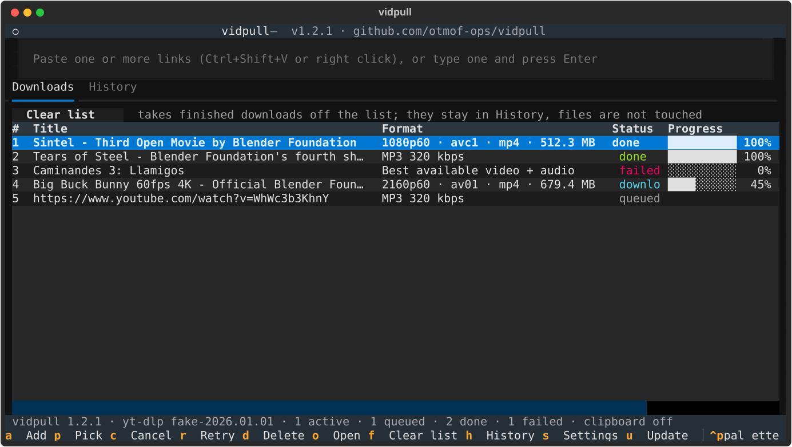

<h1 align="center">vidpull</h1>
<p align="center"><strong>Paste a link. Pick a format. Done.</strong></p>

vidpull is a terminal app for pulling video and audio off the web. Hand it a link from
YouTube, Vimeo, Twitch, TikTok, SoundCloud, Bandcamp or any of the thousand-plus sites
[yt-dlp](https://github.com/yt-dlp/yt-dlp) understands, and choose exactly what you get:

- **the video** at any resolution and frame rate the site offers, from 144p up to 4K60
- **just the audio**, as the original stream or converted to MP3 (with cover art), M4A, Opus, FLAC or WAV
- **a whole playlist** in one go

One screen, keyboard only, live progress. It updates itself from tagged releases and can
uninstall itself without leaving a trace.

<p align="center"></p>

## Install

```sh
git clone https://github.com/otmof-ops/vidpull && cd vidpull && ./install.sh
```

You need Linux with Python 3.12 or newer and ffmpeg. Missing something? The installer, and
later the app itself, notices, tells you exactly what it would download and from where, and
installs it the moment you say yes (`sudo apt install ffmpeg` and the like; nothing runs
without your yes). Everything else, including the JavaScript runtime YouTube now requires,
comes with vidpull, and the installer puts `vidpull` on your PATH.

Prefer pipx? `pipx install git+https://github.com/otmof-ops/vidpull` then
`pipx inject vidpull deno` works too; you then update with `pipx upgrade vidpull` instead of
the built-in updater.

## Use it

```sh
vidpull                                   # open it and paste a link (or several)
vidpull https://youtu.be/aqz-KE-bpKQ      # or hand it the link on the way in
```

Paste however your terminal pastes (Ctrl+Shift+V, right click, middle click; Ctrl+V works
too), with the link box focused or not. Several links at once are fine: you get a picker
for each in turn, or press Ctrl+A in the first one to use that choice for all of them.
The picker opens with what the site actually has:

| Tab | What you can pick |
| --- | --- |
| **Video** | one row per resolution and frame rate, best codec first; press `a` to see every single format |
| **Audio** | the site's own audio streams, with codec, bitrate and language, saved as they are |
| **Convert** | MP3 at 320, 256, 192 or 128 kbps or VBR best, M4A, Opus, FLAC, WAV |
| **Presets** | "best", "up to 1080p", "audio as MP3" and friends, also for whole playlists |

Press Enter on a row and the download starts. Files land in `~/Videos/vidpull`; press `o` to
open the folder.

<p align="center"></p>

| Key | Does |
| --- | --- |
| `a` / `v` | focus the link box / paste from the clipboard (any terminal paste works too) |
| `c` / `r` / `d` | cancel, retry, delete the selected download (delete can take the files with it) |
| `o` | open the download folder |
| `u` / `x` | update vidpull, or remove it |
| `s` / `l` / `?` | settings, log, help |
| `q` | quit; anything still downloading picks up where it left off next time |

### Without the picker

```sh
vidpull get URL                 # best video and audio
vidpull get URL -q 720p         # cap the resolution: 2160p, 1440p, 1080p, 720p, 480p, 360p
vidpull get URL -a mp3          # MP3 at 320 kbps; also -a mp3:192, -a m4a, -a opus, -a flac, -a wav, -a best
vidpull get URL --list          # every format with its id, then: vidpull get URL -F 299+140
vidpull get URL --playlist      # the whole playlist the link belongs to
```

### Spotify links

Paste a Spotify track, album or playlist link (or a `spotify:` URI) and vidpull queues one job per
song. The audio does not come from Spotify: [spotDL](https://github.com/spotDL/spotify-downloader)
reads the track list and finds each song on YouTube Music, and vidpull downloads that upload with
its own engine and tags the file with the song's title, artists, album, track number, date and
cover. Songs are audio-only, MP3 320 kbps unless `song_format` or `-a` says otherwise:

```sh
vidpull get https://open.spotify.com/album/6dVIqQ8qmQ5GBnJ9shOYGE -a opus
vidpull get https://open.spotify.com/track/11dFghVXANMlKmJXsNCbNl --list   # the songs, no download
```

An album or playlist is **one row** in the queue (`G1`, `G2`, …). It appears the moment you paste
the link, shows the track list being fetched, then counts its songs through (`downloading 4/12`).
`c` on that row cancels the whole run at any stage, fetch included; `r` retries what failed;
`d` deletes it, files optional; Enter or `p` shows the songs behind it, each with its own status
and match. A run releases its songs to the queue **ten at a time** (`stage_size`); the next batch
starts when the current one is done, after `stage_pause` seconds if you set one, so a long playlist
never hammers the site. Downloads run two at a time (`concurrency`), so a 12-track album takes a few
minutes and a 600-song playlist an evening.

The first Spotify link offers to install spotDL into its own environment under
`~/.local/share/vidpull/spotdl-venv` (about 200 MB, no sudo); nothing is installed without your
yes, `vidpull update` keeps it current and `vidpull uninstall` removes it with everything else.
spotDL keeps its own settings in `~/.config/spotdl`. A song with no confident match on YouTube
Music waits as pending; `p` or `r` looks again. The quality ceiling is YouTube's stream, so a
320 kbps MP3 is still made from that source.

## Keeping it current

```sh
vidpull update                  # or press u
```

Sites change their pages and yt-dlp changes with them, so vidpull can refresh just the
engine with `vidpull update --engine-only`. An update builds the new version next to the
one you are running, checks that it works, and only then switches over; if anything goes
wrong, nothing changes, and `vidpull update --rollback` brings the previous version back
without a network connection.

## Removing it

```sh
vidpull uninstall               # or press x
```

You see the exact list of folders before anything happens: settings, queue, cache, the app
itself and its launcher. Add `--keep-config` to keep your settings or `--purge-downloads` to
also delete the files vidpull downloaded (only those; nothing else in the folder is touched).
`vidpull uninstall --dry-run` just shows the list.

## Good to know

- **Settings**: press `s`, or `vidpull config set default_preset 1080p`. The file is
  `~/.config/vidpull/config.toml`.
- **Where things live**: downloads in `~/Videos/vidpull`, the queue in
  `~/.local/state/vidpull/jobs.db`, the log next to it, the app under `~/.local/share/vidpull`.
- **Clipboard watcher** (`w`): copied media links queue up as pending and wait for your
  format choice. Off by default; nothing downloads on its own.
- **A site wants you signed in**: `vidpull get URL --cookies-from-browser firefox` (or
  chromium, chrome, brave, edge) uses that browser's session for this one run.
- **YouTube shows only a few formats, or conversions fail**: run `vidpull doctor --fix`. It
  lists what is missing (a JavaScript runtime for YouTube, ffmpeg for merging and
  converting), says what it would install, and does it when you say yes. The same check runs
  every time vidpull starts; turn it off with `vidpull config set preflight false`.
- **Something else looks off**: `vidpull doctor --online` checks the whole chain against a
  known video.

## License

BSD 3-Clause, the standard permissive license with a non-endorsement clause. In plain words: use,
copy, change and sell vidpull freely; every copy, source or binary, keeps the copyright line,
which names **Jay** and links to https://github.com/otmof-ops/vidpull; and Jay's name may not be
used to endorse or promote whatever you build from it. Full text in [LICENSE](LICENSE).
What runs alongside it, under whose terms, and the one caveat for anyone who repackages it into
a single binary: [THIRD-PARTY-NOTICES.md](THIRD-PARTY-NOTICES.md).

Built on [yt-dlp](https://github.com/yt-dlp/yt-dlp), [ffmpeg](https://ffmpeg.org) and
[Textual](https://textual.textualize.io). Contributions welcome: see
[CONTRIBUTING.md](CONTRIBUTING.md).
